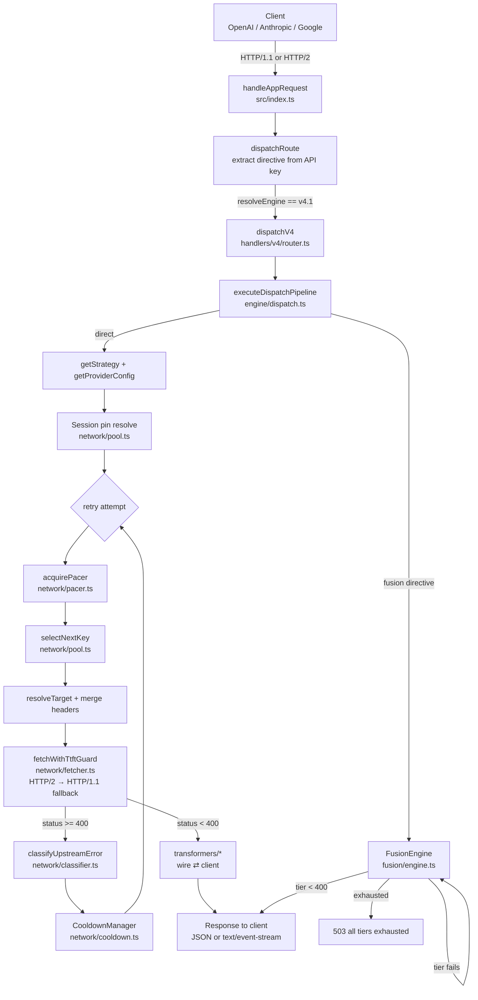

# LiteRouter Gateway

> A fast, single-runtime-dependency LLM API gateway and resilient multi-provider
> proxy built on **Bun + TypeScript**. One declarative API key routes, paces,
> translates, and fails over across OpenAI, Anthropic, Google, NVIDIA, and
> self-hosted embedding backends — with no client SDK required.

LiteRouter sits between any OpenAI-/Anthropic-/Google-shaped client and a pool of
upstream providers. The client's API key *is* the routing directive: a compact,
human-readable token selects the provider, wire dialect, endpoint, and behavioral
nuances. Behind that token the gateway enforces a single outbound pacing pipe,
reactive per-key cooldowns, session-sticky KV-cache pinning, multi-tier fusion
fallback, and cross-wire payload translation.

---

## Engineering Highlights

- **One runtime dependency (`zod`).** Everything else is Bun and the standard
  library. Fast cold start, small surface, no transitive dependency churn.
- **Declarative directive routing.** The API key encodes intent as
  `lr-<provider>-<wire>-<endpoint>-<nuance>` (e.g. `lr-or-oa-ch-no`), parsed
  against closed code sets — no client-side configuration to drift.
- **Single-pipe `RequestPacer`.** All keys for a provider share one FIFO pacing
  pipe with jitter and a bounded queue, shaping *outbound* timing so a burst of
  keys cannot stampede an upstream.
- **Reactive `CooldownManager`.** Per-key quarantine TTLs derived from HTTP
  status and `Retry-After`, with verified-quota conservation so generic `429`s
  rotate keys without benching accounts (no self-DoS).
- **Session-sticky LRU KV-cache pinning.** Inbound session IDs (`session_id`,
  `prompt_cache_key`) pin a key with true LRU eviction (`delete`-then-`set`),
  preserving upstream prompt-cache locality instead of destroying it with
  stateless round-robin.
- **Multi-tier `FusionEngine`.** Ordered provider tiers per `preset:model` with a
  sticky last-successful-tier cache, so a model that only works on a fallback
  tier is attempted there first next time.
- **Cross-wire translation.** A `PayloadTransformerContract` translates between
  OpenAI Chat, Anthropic Messages, and Google dialects in both directions,
  including streaming SSE reconstruction and in-band error forwarding.

---

## Architecture



The full request lifecycle, directive grammar, and the three cooperating
rate/concurrency primitives are documented in
[`docs/architecture.md`](docs/architecture.md).

---

## Quickstart

**Prerequisites:** [Bun](https://bun.sh) `>= 1.1`.

```bash
# 1. Install dependencies (only zod)
bun install

# 2. Create your local config from the sanitized examples
cp .env.example .env
cp config/location.json.example config/location.json
cp config/providers.example.json config/providers.json
cp config/fusion.example.json config/fusion.json

# 3. Edit .env — set your provider API keys (comma-separated N-key pools)
#    e.g. OPENROUTER_API_KEYS=sk-or-key1,sk-or-key2

# 4. Start the gateway (defaults to http://127.0.0.1:7766)
bun run start
```

Then point any OpenAI-compatible client at `http://127.0.0.1:7766/v1` and use a
directive token as the API key:

```bash
curl http://127.0.0.1:7766/v1/chat/completions \
  -H "Authorization: Bearer lr-or-oa-ch-no" \
  -H "Content-Type: application/json" \
  -d '{"model":"openai/gpt-oss-120b","messages":[{"role":"user","content":"2+2?"}]}'
```

### Verify

```bash
bun run typecheck   # tsc --noEmit, zero errors
bun test            # 100% offline unit suite with mock stubs
```

---

## Documentation

| Document | Contents |
|----------|----------|
| [`docs/architecture.md`](docs/architecture.md) | Request lifecycle, directive grammar, dispatch + fallback pipeline, pacing/cooldown/fusion primitives, cross-wire transformers. |
| [`docs/lessons-learned.md`](docs/lessons-learned.md) | Six production pitfalls and their fixes: KV-cache locality, quota quarantine vs. self-DoS, SSE mid-stream errors, trailing-assistant normalization, thought-signature failover, HTTP/2 fallback. |
| [`docs/eval-harness.md`](docs/eval-harness.md) | Native Bun 3-pillar evaluation harness (speed, agentic coding, web DOM/a11y) for rapid model triage. |

---

## Configuration

| File | Purpose |
|------|---------|
| `.env` | Server host/port, auth key, per-provider key pools and base URLs. |
| `config/location.json` | Host, port, and TLS — the single authority for server binding. |
| `config/providers.json` | Provider registry: codes, endpoints, retry, pacer, and conserve rules. |
| `config/fusion.json` | Fusion presets and native model fallback chains. |

All `*.example.json` / `.env.example` files are committed as sanitized templates;
the live files are git-ignored.

---

## License

Provided as an engineering showcase. See the repository for details.