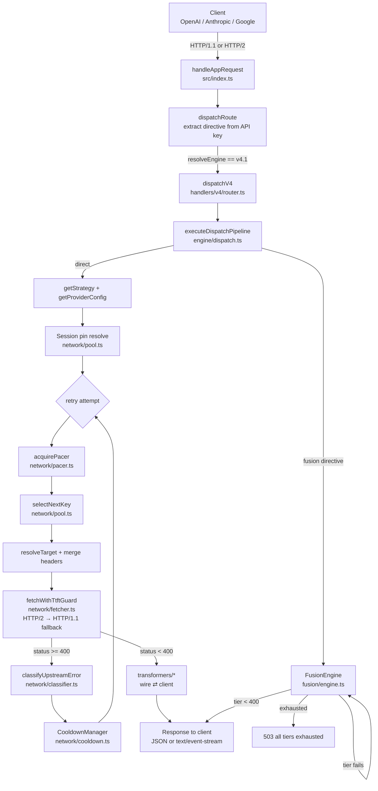

# LiteRouter Gateway

> Enterprise-grade LLM gateway resilience, scaled down to a solo-developer footprint: **1 Bun process, 1 runtime dependency (`zod`), zero Redis/Docker/Postgres.**

Most LLM proxies sit at one of two extremes: heavyweight multi-service stacks built for large platform teams, or thin round-robin wrappers that break under real traffic. **LiteRouter** brings production fault tolerance—provider-specific retry state machines, single-pipe pacing, verified quota conservation, session-sticky LRU KV-cache pinning, and cross-wire translation—into a single-process TypeScript gateway **battle-tested in daily use for over a year**.

---

## Design Decisions That Matter in Production

- **Zero-SDK steering via directive-encoded API keys.** Instead of forcing custom `X-*` headers or server-side virtual-key tables, the bearer token itself encodes routing intent as `lr-<provider>-<wire>-<endpoint>-<nuance>` (e.g. `lr-or-oa-ch-no`), with optional caller-hash suffixes for attribution. `body.model` stays untouched and upstream-native, while admin/trace routes remain strictly isolated behind constant-time `LITEROUTER_AUTH_KEY` (`timingSafeEqual`) verification.
- **Provider-specific failure semantics (not a global `retry(3)`).** Upstream providers fail differently: `403` billing guardrails fail fast, generic `429`s rotate keys without benching accounts (preventing self-DoS), verified quota depletion triggers `CooldownManager` conservation via single-flight probe (`openrouter_probe.ts`), `502`/`504` transport drops use bounded grace retries, and multi-tier `FusionEngine` cascades across providers.
- **KV-cache locality over naive round-robin.** Stateless round-robin destroys prompt-cache hit rates on providers that scope caches per key. Inbound session IDs (`session_id`, `prompt_cache_key`, headers) pin a key with true LRU eviction (`delete`-then-`set`), breaking the pin only on `402`/`429` rotation.
- **Single-pipe `RequestPacer` + bounded footprint.** All keys for a provider share one FIFO pacing pipe with jitter and a bounded queue so bursts cannot stampede an upstream, backed by a single runtime dependency (`zod`) and fast cold start.
- **Cross-wire translation & SSE stream resilience.** `PayloadTransformerContract` translates between OpenAI Chat/Responses, Anthropic Messages, and Google dialects in both directions, including HTTP/2-to-HTTP/1.1 fallback (`fetchWithTtftGuard`) and mid-stream in-band error forwarding.

---

## Architecture



The full request lifecycle, directive grammar, and the three cooperating
rate/concurrency primitives are documented in
[`docs/architecture.md`](docs/architecture.md).

---

## Quickstart

**Prerequisites:** [Bun](https://bun.sh) `>= 1.1`.

```bash
# 1. Install dependencies (only zod)
bun install

# 2. Create your local config from the sanitized examples
cp .env.example .env
cp config/location.json.example config/location.json
cp config/providers.example.json config/providers.json
cp config/fusion.example.json config/fusion.json

# 3. Edit .env — set your provider API keys (comma-separated N-key pools)
#    e.g. OPENROUTER_API_KEYS=sk-or-key1,sk-or-key2

# 4. Start the gateway (defaults to http://127.0.0.1:7766)
bun run start
```

Then point any OpenAI-compatible client at `http://127.0.0.1:7766/v1` and use a
directive token as the API key:

```bash
curl http://127.0.0.1:7766/v1/chat/completions \
  -H "Authorization: Bearer lr-or-oa-ch-no" \
  -H "Content-Type: application/json" \
  -d '{"model":"openai/gpt-oss-120b","messages":[{"role":"user","content":"2+2?"}]}'
```

### Verify

```bash
bun run typecheck   # tsc --noEmit, zero errors
bun test            # 100% offline unit suite with mock stubs
```

---

## Documentation

| Document | Contents |
|----------|----------|
| [`docs/architecture.md`](docs/architecture.md) | Request lifecycle, directive grammar, dispatch + fallback pipeline, pacing/cooldown/fusion primitives, cross-wire transformers. |
| [`docs/lessons-learned.md`](docs/lessons-learned.md) | Six production pitfalls and their fixes: KV-cache locality, quota quarantine vs. self-DoS, SSE mid-stream errors, trailing-assistant normalization, thought-signature failover, HTTP/2 fallback. |
| [`docs/eval-harness.md`](docs/eval-harness.md) | Native Bun 3-pillar evaluation harness (speed, agentic coding, web DOM/a11y) for rapid model triage. |

---

## Configuration

| File | Purpose |
|------|---------|
| `.env` | Server host/port, auth key, per-provider key pools and base URLs. |
| `config/location.json` | Host, port, and TLS — the single authority for server binding. |
| `config/providers.json` | Provider registry: codes, endpoints, retry, pacer, and conserve rules. |
| `config/fusion.json` | Fusion presets and native model fallback chains. |

All `*.example.json` / `.env.example` files are committed as sanitized templates;
the live files are git-ignored.

---

## License

Provided as an engineering showcase. See the repository for details.