# LiteRouter Gateway — Architecture

This document describes the request lifecycle of the v4.1 gateway: how a client
request enters through `src/index.ts`, is routed by the v4.1 router, dispatched
through `src/engine/dispatch.ts`, transformed to the upstream wire, and finally
fetched — together with the three cooperating rate/concurrency primitives
(`RequestPacer`, `CooldownManager`, `FusionEngine`) and the declarative directive
grammar.

All file paths and symbol names below are taken verbatim from the source tree.

---

## 1. Boot & Server Construction

`src/index.ts` is the process entry point. On `import.meta.main` it calls
`createServer()`, which:

1. Initializes the provider registry (`initProviderRegistry`), the strategy
   registry (`initStrategyRegistry`), the trace writer (`traceWriter.init`), the
   key pools (`initializeKeyPools`), and the native Google model chains
   (`loadAndCacheNativeChains`).
2. Loads the single authority for host/port/TLS — `loadLocationConfig()` from
   `config/location.json` — with `LITEROUTER_PORT` / `LITEROUTER_HOST` as
   optional overrides.
3. Prints the startup banner (`printBanner`) with the active per-provider key
   pool sizes.
4. Serves requests. When TLS + `LITEROUTER_HTTP2` are enabled it builds a
   `node:http2` secure server (`createSecureServer`) that pipes each HTTP/2
   stream into the shared Web-standard handler via `pipeWebResponseToNode`.
   Otherwise it uses `Bun.serve({ fetch })`.

Both server flavors funnel every request into `handleAppRequest(req)`, which
assigns a request id (`x-request-id` / `x-req-id` or a generated
`req_<random>`), extracts the directive token (`extractDirectiveToken`), and
delegates to `dispatchRoute`. Client aborts are normalized to HTTP `499`; the
process installs `SIGINT`/`SIGTERM` handlers that `drainInFlight` before exit.

---

## 2. Request Lifecycle

```
Client
  │  HTTP/1.1 or HTTP/2 (TLS)
  ▼
createServer / Bun.serve  ──►  handleAppRequest(req)        [src/index.ts]
  │                              • assign reqId
  │                              • extractDirectiveToken(rawKey)
  ▼
dispatchRoute(req, rawKey, reqId)                            [src/index.ts]
  │   • system routes: /health, /reset, /admin/pool/reset
  │   • /v1/models…  → dispatchModelsRoute → parseDirective → handleModelsDiscovery
  │   • embeddings default directive / resolveInferenceAuth (master-secret check)
  │   • resolveEngine(req) === "v4.1" ?
  ▼
dispatchV4(req, rawKey, reqId)          [src/handlers/v4/router.ts]
  │   • parse directive → build PayloadTransformerContract
  │   • build DispatchRequest (outboundPayload, transformer, clientSignal, headers)
  ▼
executeDispatchPipeline(req, fetchFn)   [src/engine/dispatch.ts]
  │   • fusion directive? → executeFusionFlow(...)  [src/handlers/openai_compat.ts]
  │   • direct: resolve provider config + strategy (getStrategy)
  │   • telemetry + session pin (extractClientSessionId / extractBodySessionId)
  │   • retry loop: acquirePacer → selectNextKey → resolveTarget → mergeOutboundHeaders
  ▼
fetchWithTtftGuard(...) → fetcher.ts (HTTP/2 with HTTP/1.1 fallback)  [src/network/fetcher.ts]
  │   • TTFT guard (readFirstContentChunkWithTimeout)
  ▼
transformer.createWireToClientStream / transformWireToClient  [src/transformers/*]
  │
  ▼
Response (JSON or text/event-stream) → client
```

The non-v4.1 path in `dispatchRoute` remains for legacy routes
(`ROUTE_MAP`, `dispatchResponsesRoute`, `dispatchGcpRoute`,
`dispatchGoogleBeta`) but the v4.1 engine is the default for inference traffic.

---

## 3. Dispatch + Fallback Pipeline (v4.1)

```mermaid
flowchart TD
    A[handleAppRequest<br/>src/index.ts] --> B[dispatchRoute]
    B -->|resolveEngine == v4.1| C[dispatchV4<br/>handlers/v4/router.ts]
    C --> D[executeDispatchPipeline<br/>engine/dispatch.ts]
    D -->|directive.type == fusion| F[executeFusionFlow<br/>handlers/openai_compat.ts]
    D -->|direct| E[getStrategy + getProviderConfig]

    E --> G[session pin resolve<br/>extractClientSessionId / extractBodySessionId]
    G --> H{retry attempt<br/>1..maxAttempts}
    H --> I[acquirePacer<br/>network/pacer.ts]
    I --> J[globalKeyPool.selectNextKey<br/>network/pool.ts]
    J -->|no key available| K[429 keys_exhausted]
    J --> L[resolveTarget + mergeOutboundHeaders]
    L --> M[fetchWithTtftGuard<br/>network/fetcher.ts]
    M -->|status < 400| N{streaming?}
    N -->|yes| O[pipeThrough wire stream<br/>+ createCutoffResilientStream]
    N -->|no| P[transformWireToClient → JSON]
    M -->|status >= 400| Q[classifyUpstreamError<br/>network/classifier.ts]
    Q --> R{session 402/429?}
    R -->|yes| R1[rotateSessionKey]
    Q --> S{conserve_rule match?}
    S -->|yes| S1[globalKeyPool.conserveKey]
    Q --> T{401/403?}
    T -->|yes| T1[reportFailure → FatalAuthError]
    Q --> U{failureAction}
    U -->|fail_fast| V[createCleanErrorResponse]
    U -->|advance_target| H
    U -->|retry_same_target| W[Bun.sleep backoff] --> H
    M -->|NoResponseError / TTFT| X{attempt < max?}
    X -->|yes| W
    X -->|no| Y[504 ttft_timeout]

    F --> F1[engine.createExecutionPlan<br/>fusion/engine.ts]
    F1 --> F2{for tier in orderedTiers}
    F2 -->|tier < 400| F3[handleTierSuccess → sticky cache]
    F2 -->|tier fails| F4[handleTierFailure] --> F2
    F2 -->|exhausted| F5[503 all tiers exhausted]

    O --> Z[Response to client]
    P --> Z
    V --> Z
```



### 3.1 The retry loop

`executeDispatchPipeline` runs a bounded loop (`maxAttempts` from the provider's
`request_retry` config). Each attempt:

- Checks `clientSignal.aborted` first (throws `AbortError`).
- Acquires a pacer lease via `acquirePacer(providerCode, provConfig.pacer, signal)`
  — one shared pipe per provider (see §4.1).
- Selects a key via `globalKeyPool.selectNextKey(provider, now, sessionId)`,
  honoring any session pin (§4.2). No key ⇒ `429 keys_exhausted`.
- Resolves the upstream target (`strategy.resolveTarget` or `defaultTarget`),
  applies `overrideProviderUrl`, and merges outbound headers
  (`mergeOutboundHeaders`, which strips hop-by-hop headers via
  `BANNED_OUTBOUND_HEADERS` and re-injects session headers).
- Calls `fetchWithTtftGuard` and branches on status.

### 3.2 Failure classification & the three failure actions

On `status >= 400`, `classifyUpstreamError` (in `network/classifier.ts`)
produces a classification, and the strategy's `classifyFailure`
(`defaultClassifyFailure` in `engine/status_classify.ts`) yields a
`FailureAction`:

- `fail_fast` — return a sanitized error (`createCleanErrorResponse`) with no
  retry (e.g. a `400`).
- `advance_target` — rotate to the next key/target and `continue` the loop.
- `retry_same_target` — `Bun.sleep(delay)` (honoring `Retry-After`, capped) then
  retry.

Transport faults raise `NoResponseError` (TTFT/transport) which retries until
`maxAttempts`, then returns `504 ttft_timeout`.

---

## 4. Rate & Concurrency Primitives

Three independent mechanisms cooperate. They are deliberately separate: pacing
shapes *outbound* request timing, cooldowns quarantine *individual keys*, and
fusion orders *provider tiers*.

### 4.1 Single-pipe `RequestPacer` (`src/network/pacer.ts`)

`RequestPacer` enforces a minimum inter-dispatch interval
(`getMinInterval()` from `min_delay_ms` / `max_rpm`) through a single
`FastFifoQueue`. If the queue is empty, the interval has elapsed, and the
concurrency budget allows, `acquire()` returns immediately (`canBypass`).
Otherwise the request is enqueued and drained one-per-tick by `scheduleDrain` /
`dispatchNext`, with optional randomized jitter (`max_delay_ms`).

A global `pacerRegistry` (`getPacerForProvider`) keys one `RequestPacer` per
provider — **all keys for a provider share the single pipe**. `maxQueueDepth`
overflow throws `PacerQueueOverflowError` carrying a `retryAfterSec`. `acquire`
returns a `PacerAcquireResult` whose `release()` decrements `activeInFlight`;
the dispatch loop always releases the lease (success, failure, or stream
completion).

### 4.2 Reactive `CooldownManager` + `KeyPool` (`src/network/cooldown.ts`, `src/network/pool.ts`)

`CooldownManager` maps a `keyId` (`provider:index`) to a `KeyCooldownState`
(`quarantinedUntil`, `reason`, `lastErrorStatus`). `quarantineKey` derives the
TTL from the HTTP status (`computeStatusTtlSec`) or a `Retry-After` header / body
(`parseResetDelay`). `quarantineKeyWithTtl` applies an explicit TTL (used by
conserve rules). `isQuarantined` lazily purges expired entries.

`KeyPool` (an `EventEmitter`) wraps a `CooldownManager` and adds:

- Round-robin selection (`selectRoundRobinKey`) that skips quarantined keys.
- **Session-sticky LRU pinning** (`sessionPins`): `selectNextKey` resolves a
  pinned key for a session, else round-robins and pins the result.
  `pinSessionKey` / `getPinnedKey` do `delete`-then-`set` for true LRU
  eviction (`evictOldestSessionPin`); pins expire after
  `DEFAULT_SESSION_PIN_TTL_MS` and are bounded by
  `DEFAULT_SESSION_PIN_MAX_ENTRIES`.
- `rotateSessionKey` (used on `402`/`429`) to move a session to a fresh key.
- `reportSuccess` (clears cooldown), `reportFailure` (quarantines, and throws
  `FatalAuthError` on `401`/`403` after invalidating bound pins), and
  `conserveKey` (explicit-TTL quarantine for verified quota exhaustion).
- Availability timers (`scheduleAvailabilityTimer`) that emit `available:<provider>`
  so `waitForKeyAvailable` can wake waiters.

### 4.3 Multi-tier `FusionEngine` (`src/fusion/engine.ts`)

`FusionEngine` resolves a fusion preset + requested model into an ordered list of
`FusionTier`s (`createExecutionPlan`, sorted by `priority`). A
`StickyPositionCache` (`src/fusion/sticky.ts`) remembers the last successful
non-primary tier for a `preset:model` (5-minute `FUSION_STICKY_TTL_MS`) so a
model that only works on a fallback tier is attempted there first next time;
`handleTierSuccess` clears the sticky on a priority-1 success and sets it on a
fallback success, `handleTierFailure` clears it when the failed tier was sticky.

`executeFusionFlow` (in `src/handlers/openai_compat.ts`) consumes the plan: it
iterates `orderedTiers` under a total `timeout_ms` budget, calling
`tryExecuteTier` per tier with a per-tier sub-budget. A `< 400` result returns
immediately (recording sticky success); a `null` result records a tier failure
and advances; a terminal error returns at once. Exhausting all tiers yields
`503 all tiers exhausted`.

---

## 5. Declarative Directive Grammar

Directives are parsed by `parseDirective` in `src/directive/parser.ts`. A
directive is the client's API key. Two shapes exist:

### 5.1 Direct directive — `lr-<provider>-<wire>-<endpoint>-<nuance>`

Five `-`-separated parts. `parseDirectKey` validates each part against the
closed code sets and returns a frozen `DirectDirective`:

| Position | Field        | Type             | Examples            |
|----------|--------------|------------------|---------------------|
| `lr`     | prefix       | literal          | `lr`                |
| 1        | `provider`   | `ProviderCode`   | `or`, `nv`, `gg`, `oa`, `an`, `zn`, `gc`, `tei` … |
| 2        | `payload`/`wire` | `WireProtocol` | `oa`, `oo`, `cl`, `gg`, `rs`, `ao` |
| 3        | `completion`/`endpoint` | `CompletionCode` | `ch`, `ms`, `rs`, `em`, `im`, `md` … |
| 4        | `nuances`    | `NuanceCode[]`   | `no`, `dp`, `ts`, `sb`, `tc`, `lg`, `ds` … (`+`-joined) |

Example: `lr-or-oa-ch-no` → provider `or`, OpenAI wire, chat completions, no
nuance. The `wire` selects the inbound-payload dialect; the `endpoint` selects
the API surface and is validated against the request path by
`validateEndpointMatch` (`src/index.ts`) — e.g. an `-em-` directive on a
non-embeddings path is a `400` endpoint mismatch.

### 5.2 Fusion directive — `lr-fse-<preset>`

Three parts; `parseFusionKey` requires `parts[1] === "fse"` and a non-empty
`preset`, returning a `FusionDirective` that routes into `executeFusionFlow`.

---

## 6. Cross-Wire Transformers (`src/transformers/`)

The v4.1 engine is wire-agnostic: a `PayloadTransformerContract`
(`transformClientToWire`, `transformWireToClient`, `createWireToClientStream`)
sits between the client payload and the upstream payload.

- `anthropic_openai_xwire.ts` — `AnthropicOpenAIXWireTransformer` translates
  Anthropic Messages ⇄ OpenAI Chat. Request translation
  (`translateAnthropicToOpenAI`) maps system/assistant/user blocks, tool
  definitions (`translateTools`), and tool choices; it calls
  `ensureTerminalUserTurn` to guarantee a terminal user turn. Streaming
  translation (`createAnthropicXWireStreamTransformer`) rebuilds Anthropic SSE
  events (`message_start`, `content_block_*`, `message_delta`, `message_stop`)
  from OpenAI deltas, tracking thinking/text/tool_use blocks and emitting
  in-band `error` events via `handleSseErrorChunk`.
- `thinking.ts` — reasoning scrubbing (`scrubReasoningFromMessages`,
  `deleteReasoningKeys`), the OpenCode reasoning filter stream
  (`createOpenCodeReasoningFilterStreamTransformer`), `<think>`-tag
  streaming (`processThinkingDelta`), and `ensureTerminalUserTurn`.
- `opencode_adapter.ts` — the per-message/choice reasoning scrubbers and
  `normalizeToolContent` reused by the other transformers.

Thought signatures for cross-model tool-call failover are handled in
`anthropic_openai_xwire.ts`'s sibling store (see `lessons-learned.md`).

---

## 7. Outbound Fetch & Stream Resilience (`src/network/fetcher.ts`)

`fetchWithTtftGuard` is the single outbound entry. It merges the client signal
with a timeout (`mergeSignals`), forces `accept-encoding: identity`, and — when
`LITEROUTER_H2_OUTBOUND` is set, the URL is `https`, and fetch is not mocked —
attempts an HTTP/2 request via `executeH2Fetch` (using the pooled session from
`getHttp2Pool`). Any H2 transport error that is not a client abort falls back
cleanly to standard `fetch` (HTTP/1.1). It then reads the first content chunk
under a TTFT deadline (`readFirstContentChunkWithTimeout`); a `200` with zero
content tokens raises `NoResponseError` ("ghost response").

Streaming responses are wrapped by `createResilientStream`, which buffers to
line boundaries, detects in-band error chunks (`isInBandErrorChunk`), forwards
mid-stream error frames (`emitStreamError` / `formatMidstreamErrorFrame`),
emits keep-alive comments, and supports a `retryProvider` /
`nextAttemptProvider` callback for clean failover. `reassembleResponse`
re-injects a consumed first chunk without corrupting SSE delimiters.

---

## 8. Telemetry & Lifecycle

`RequestTelemetry` (`src/telemetry/session.ts`) records inbound/resolved-model
legs, TTFT (`markTtft`), key index, session pin, usage (`recordUsage`, with
per-wire token aliases resolved in `extractUsage`), limit events
(`recordLimit`), key rotations (`rotateKey`), and the served status. Traces are
pushed to `traceBuffer` (in-memory ring) and `traceWriter` (async writer),
sanitized via `sanitizeBody`. `src/lifecycle/shutdown.ts` tracks in-flight
requests (`trackInFlight` / `drainInFlight`) so `SIGINT`/`SIGTERM` drain
gracefully. `handleHardReset` (`/reset`) clears cooldowns, circuit breakers,
pacers, H2 pools, and the trace buffer behind a master-secret check.